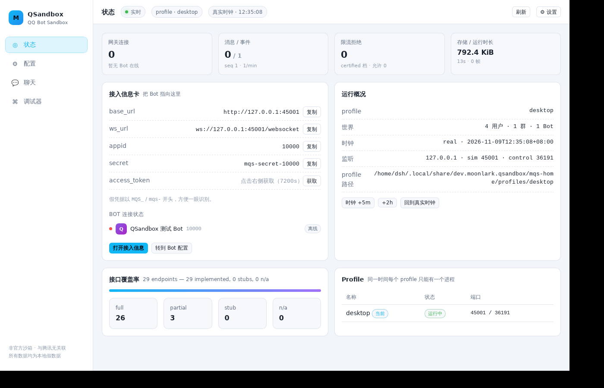

# Moonlark QSandbox

[](https://github.com/Moonlark-Dev/qsandbox/actions/workflows/ci.yml)
[](https://github.com/Moonlark-Dev/qsandbox/actions/workflows/release.yml)

Moonlark QSandbox（MQS）是一个 QQ Bot API 沙箱：您可以在里面随意创建虚拟用户与群，把真实 SDK 指向它，验证 Bot 的收发、被动回复、主动消息配额、限流与异常分支。

服务端是 **Rust**（单个二进制，内嵌 GUI 与 SQLite），桌面端是 **Tauri v2**（同一进程内启动服务，不再有 sidecar）。只有 **botpy 垫片**仍然用 Python——那是 SDK 的猴补丁，属于 Python 生态，不需要也不应该编译进二进制。

## 架构一览

```
mqs binary (Rust)
  ├─ Simulate API  :5700   QQ 兼容 /v2/* + 网关 WebSocket
  ├─ Control API   :5701   GUI / CLI / MCP（token + Origin 保护 + 内嵌 Vue 资源）
  └─ SQLite + media        单进程、WAL、内容哈希寻址

desktop/src-tauri          Tauri 窗口，内嵌同一个 server crate（一个安装包，无 sidecar）
python/                    mqs-compat：botpy 垫片（唯一的 Python 部分）
web/                       Vue 3 + Vite 前端（桌面与浏览器共用）
```

## 快速开始

```bash
# 从源码构建（Rust 1.85+）
cargo build --release -p mqs
./target/release/mqs serve
#    Simulate API : http://127.0.0.1:5700
#    Gateway      : ws://127.0.0.1:5700/websocket
#    Control GUI  : http://127.0.0.1:5701/#t=...   ← 浏览器打开即可
```

首次启动会自动创建 1 个可操作账号、3 个 npc、1 个群与默认 Bot。

**默认测试 Bot**

| 字段 | 值 |
|---|---|
| appid | `10000` |
| secret | `mqs-secret-10000` |
| token | `POST /app/getAppAccessToken`，或 `mqs token` |

## 使用 botpy

botpy 把 REST 域名与 token URL 写死在源码里，因此需要仓库自带的垫片：

```bash
pip install qq-botpy ./python        # 或 pipx
```

```python
import mqs.compat.botpy  # noqa: F401  ← 必须在 import botpy 之前
import botpy
from botpy.message import GroupMessage

class Echo(botpy.Client):
    async def on_group_at_message_create(self, message: GroupMessage):
        await message.reply(content=f"echo: {message.content}")

Echo(intents=botpy.Intents(public_messages=True)).run(appid="10000", secret="mqs-secret-10000")
```

完整示例见 [examples/botpy_echo/bot.py](examples/botpy_echo/bot.py)，已知差异见 [docs/COMPAT.md](docs/COMPAT.md)。

## 命令行

```bash
mqs status --json                       # 运行状态 / 端口 / token / 覆盖率
mqs token --bot 10000                   # 直接打印 App Access Token
mqs user create --name 小明 --random     # 建虚拟用户
mqs user list --available               # 可操作账号
mqs group create --name 测试群 --members 5
mqs send --as-user u_000001 --to group:g_000002 --text "你好" --no-at
mqs expect --event group_at_message_create --timeout 3s
mqs clock advance 6m                    # 快进虚拟时钟（被动窗口/配额/token 过期）
mqs script run smoke --junit out.xml    # 需要 echo bot 在线
mqs logs -f --kind ws                   # 调试帧
mqs doctor                              # 环境自检
mqs contract export                     # 覆盖率文档 + 前端 TS 类型
mqs mcp                                 # stdio MCP server（10 个工具）
```

全部命令支持 `--json`；退出码：0 成功 / 2 用法 / 3 连接失败 / 4 端口或锁冲突 / 5 场景失败。

## 能力矩阵

| 层 | 已实现 |
|---|---|
| **鉴权** | `getAppAccessToken`、`Authorization: QQBot <token>`、7200s 过期（受虚拟时钟控制）、11241/11242/11243/11244 |
| **网关** | hello / identify / ready / heartbeat / resume / invalid session、intents、分片、断线补发、4002/4004/4006/4009/4010 |
| **群 / C2C 消息** | 文本、markdown（含 @ 用户 / 指令标签）、keyboard（指令/回调/链接）、ark、embed、媒体、引用、撤回、`msg_id+msg_seq` 去重、被动窗口与次数 |
| **群消息语义** | 全量消息（`GROUP_MESSAGE_CREATE` + `mentions[].is_you`）与仅 @（`GROUP_AT_MESSAGE_CREATE` + `<@!openid>` 前缀）两套事件，按群内 Bot 的 `recv_msg_setting` 切换；`at_bots` 显式投递 |
| **群管理** | 群信息、机器人群内状态、成员禁言、黑名单、批量移除、入群申请审批（内邀白名单 11253） |
| **群成员** | 成员列表 / 单人信息（白名单接口，60/30 QPM，游标分页） |
| **主动消息** | Bot 级 + 群级开关；未认证/已认证两档滑动窗口限流；单关系 20/min；每日 1000 条配额（40055） |
| **媒体** | `file_type` 1/2/3、url / multipart / base64 / 分片上传（prepare → part → finish）、内容哈希寻址下载 |
| **事件投递** | WebSocket 与 Webhook 双通道、Ed25519 握手与签名、事件溯源（RESUME 补发） |
| **可观测** | 双向 HTTP/WS 帧、事件流、限流拒绝、吞吐、DB 大小、覆盖率实时统计、虚拟时钟 |
| **Agent** | CLI（`--json` / 稳定退出码）、MCP stdio（10 个工具）、10 个 YAML 场景 + JUnit/TAP |
| **GUI** | 状态 / 配置 / 聊天 / 调试器 / 设置；规则引擎、群管理、文件粘贴拖拽、账号切换快捷键 |
| **桌面端** | Tauri v2 安装包（Linux deb/AppImage、Windows exe/msi、macOS dmg），内嵌服务，无 sidecar |



实时覆盖率：`GET /_mqs/contract`，或 [docs/COVERAGE.md](docs/COVERAGE.md)（由 `mqs contract export` 生成）。

## 频率与时效（严格对齐 QQ 官方文档）

| 类型 | 场景 | 规则 |
|---|---|---|
| 被动 | 单聊 | 60 分钟 / 每条消息 4 次回复 |
| 被动 | 群聊 | 5 分钟 / 每条消息 5 次回复 |
| 主动 | 单聊 · 未认证 | Bot 5/s 且 30/min；单关系 20/min；1000/天/用户 |
| 主动 | 单聊 · 已认证 | Bot 10/s；单关系 20/min；1000/天/用户 |
| 主动 | 群聊 · 未认证 | Bot 30/min；单关系 20/min；1000/天/群 |
| 主动 | 群聊 · 已认证 | Bot 60/min；单关系 20/min；1000/天/群 |

个人认证与企业认证限额一致，UI 合并为 **关 / 未认证 / 已认证** 三档。实现用滑动窗口（不是令牌桶）；429 带 `Retry-After` 与 `X-RateLimit-*`。

## 目录结构

```
crates/mqs/
  src/
    world.rs     世界模型（用户/Bot/群/会话/消息/事件/媒体/帧/规则）
    messages.rs  收发语义（被动窗口、去重、@、按钮、撤回）
    community.rs 群管理（内邀接口）
    gateway.rs   网关协议状态机
    sim.rs       模拟 QQ API + WebSocket
    control.rs   控制 API + 内嵌 GUI
    http.rs      状态、QQ 错误封装、鉴权提取器、中间件
    scenario.rs  YAML 场景引擎（JUnit/TAP）
    contract.rs  端点注册表 + 覆盖率/TS 生成
    cli.rs       命令行
    mcp.rs       MCP stdio
    server.rs    双端口监听与生命周期
  tests/         集成测试（对照真实行为）
desktop/src-tauri/  Tauri 桌面壳
web/             Vue 3 + Vite 前端
python/          mqs-compat（botpy 垫片）
scenarios/       YAML 场景（内置模板同源于此）
examples/        botpy echo bot
docs/            COMPAT.md / COVERAGE.md
```

## 开发

```bash
cargo fmt --all
cargo clippy --all-targets -- -D warnings
cargo test -p mqs                  # 单元 + 集成测试

cd web && npm install
npm run typecheck                  # vue-tsc --noEmit
npm run build                      # 产物会被 mqs 二进制内嵌（构建时存在才会内嵌）

# 桌面端（需要系统 WebKitGTK / WebView2 / WKWebView）
cd desktop && npm install && npm run dev          # tauri dev
cd desktop && npm run build                       # tauri build → 安装包
```

## 安全

- 默认只监听 `127.0.0.1`；`--host 0.0.0.0` 必须显式提供 `--token`，并在 stderr 警告。
- 控制 API 要求 token 或 HttpOnly cookie；校验 `Origin`；前端通过 URL fragment 中的一次性 nonce 换取 cookie。
- 可选接口白名单（`feature.whitelist`，内邀接口返回 11253）/ `feature.expose=public` 隐藏内邀接口（404）；媒体路径穿越防护。
- 不做转发到真实 QQ 的代理；不落地任何真实用户数据；仓库不含真实 secret。

## 已知未做

见 [docs/UNIMPLEMENTED.md](docs/UNIMPLEMENTED.md)（按腾讯 QQ 机器人文档 v2 逐项核对）与 [docs/COVERAGE.md](docs/COVERAGE.md)。

## 许可证

AGPL-3.0-or-later

> [!WARNING]
> 该项目与腾讯无任何关联。所有账号、openid、token 均为 QSandbox 随机生成的数据。
