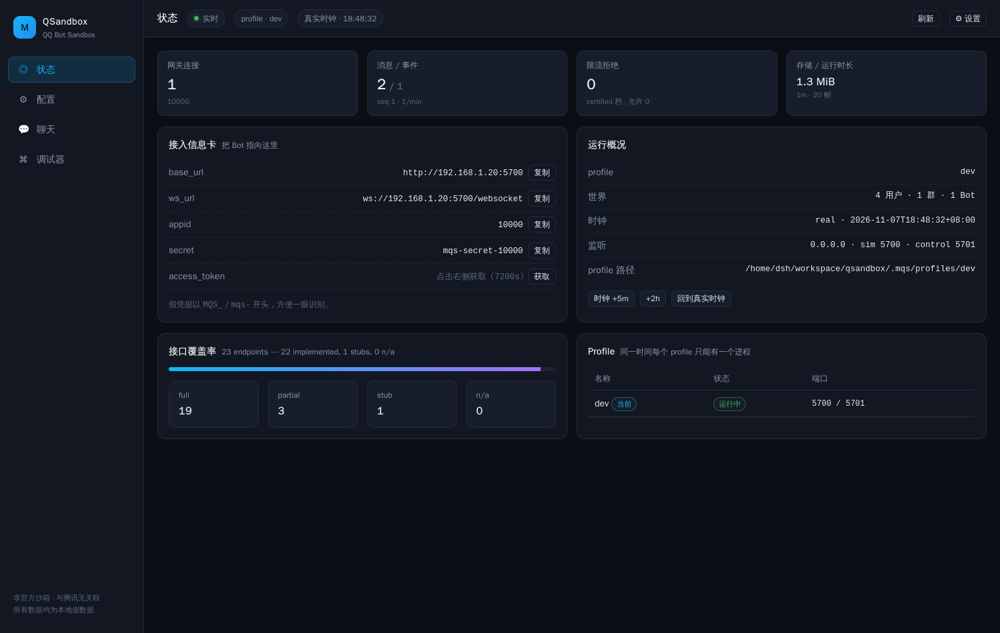

# QSandbox — Moonlark QSandbox

> QQ Bot API v2 的本地沙箱：把 `base_url` / `ws_url` 指过来，Bot 就能跑完整收发。
> **非官方项目，与腾讯无任何关联。** 所有账号、openid、token 都是 QSandbox 生成的假数据。

QSandbox 是给 [Moonlark](https://github.com/Moonlark-Dev/Moonlark) 生态和 QQ Bot 开发者用的"平台替身"：不需要 AppID 权限、不会触发真机频控、世界可复现、全程可观测。设计文档见 [PLAN.md](./PLAN.md)。

```
QSandbox 服务
  →  Simulate API :5700   (QQ 兼容 /v2/*、网关 WebSocket)
  →  Control API  :5701   (GUI / CLI / MCP，token + Origin 保护)
  →  SQLite + media       (单进程、WAL、内容哈希寻址)

Electron 桌面端（desktop/）→ 拉起 sidecar → 内嵌同一份 Vue GUI
CLI / MCP                  → 同一个控制 API，没有第二条实现
```



<sub>状态页：接入信息卡、覆盖率、profile；聊天/设置/调试器见 [docs/screenshots](./docs/screenshots)。</sub>

## 快速开始

```bash
# 1. 安装（Python 3.11+）
python3 -m venv .venv && . .venv/bin/activate
pip install -e ".[dev]"

# 2. 启动（首次自动建 1 个可操作账号 + 3 个 npc + 1 群 + 1 频道）
mqs serve
#    Simulate API : http://127.0.0.1:5700
#    Gateway      : ws://127.0.0.1:5700/websocket
#    Control GUI  : http://127.0.0.1:5701/#t=...   ← 浏览器打开（开发预览）
```

默认测试 Bot：

| 字段 | 值 |
|---|---|
| appid | `10000` |
| secret | `mqs-secret-10000` |
| token | `POST /app/getAppAccessToken` 获取，或 `mqs token` |

### 桌面端（Electron）

```bash
cd web && npm install && npm run build
cd .. && pip install -e ".[build]" && python tools/build_sidecar.py
cd desktop && npm install && npm run dist:linux   # release/QSandbox-*.AppImage
# 或开发模式：npm start（自动拉起 build-sidecar/mqs）
```

桌面端会把自己的数据放到 `app.getPath('userData')/mqs-home`，不污染仓库里的 profile。
更多见 [desktop/README.md](./desktop/README.md)。

### 把 botpy 指过来

botpy 的 `Route.DOMAIN` / token URL 是硬编码的，用仓库自带的垫片：

```python
import mqs.compat.botpy  # noqa: F401  ← 必须在 import botpy 之前
```

完整 echo bot 见 [examples/botpy_echo/bot.py](./examples/botpy_echo/bot.py)，已知差异见 [docs/COMPAT.md](./docs/COMPAT.md)。

### 不用写代码，先玩一下

```bash
mqs group create --name 测试群 --members 3
mqs send --as-user u_000001 --to group:g_000002 --text "你好"
mqs expect --event group_at_message_create --timeout 3s
mqs script run smoke            # 需要 echo bot 在线
mqs script run rate_limit       # 未认证个人单聊 5/s：第 6 条 429
mqs script run media            # multipart 上传 + msg_type=7
mqs status --json
```

## 频率与时效（严格按 QQ 官方文档）

| 类型 | 场景 | 规则 |
|---|---|---|
| 被动 | 单聊 | 60 分钟 / 每条消息 4 次回复 |
| 被动 | 群聊 | 5 分钟 / 每条消息 5 次回复 |
| 主动 | 单聊 · 未认证 | Bot 5/s 且 30/min；单关系 20/min；1000/天/用户 |
| 主动 | 单聊 · 已认证 | Bot 10/s；单关系 20/min；1000/天/用户 |
| 主动 | 群聊 · 未认证 | Bot 30/min；单关系 20/min；1000/天/群 |
| 主动 | 群聊 · 已认证 | Bot 60/min；单关系 20/min；1000/天/群 |
| 频道 | 所有消息 | 5/s/频道；主动 20/天/频道、2 频道/天 |

个人认证与企业认证限额完全一致，UI 合并为 **关 / 未认证个人 / 已认证（个人=企业）** 三档。
实现用滑动窗口，不是令牌桶；429 带 `Retry-After` 与 `X-RateLimit-*`。

## 能力矩阵（v0.2）

| 层 | 已实现 |
|---|---|
| 鉴权 | `getAppAccessToken`、`Authorization: QQBot <token>`、7200s 过期、错误码 |
| 网关 | hello / identify / ready / heartbeat / resume / invalid session、intents、分片、断线补发 |
| 群/C2C | 文本/markdown/keyboard/ark/embed/媒体、被动窗口与次数、`msg_id+msg_seq` 去重、引用、撤回、按钮点击（指令/回调/链接）、不 @ Bot 的普通群消息 |
| 频道 L2 | guild / channel / member / role、频道消息、`MESSAGE_CREATE` / `AT_MESSAGE_CREATE`、频道频控 |
| 媒体 | `file_type` 1/2/3、url / multipart / base64 `file_data` / 分片上传（prepare → part → finish）、内容哈希下载 |
| 事件 | WebSocket 与 Webhook 双投递、Ed25519 握手、事件溯源 |
| 可观测 | 双向 HTTP/WS 帧、事件流、限流拒绝、吞吐、DB 大小、覆盖率实时统计 |
| Agent | CLI（`--json` / 稳定退出码）、MCP stdio（10 个工具）、10 个 YAML 场景 + JUnit/TAP |
| GUI | Electron 桌面 + 浏览器预览：状态/配置/聊天/调试器/设置，规则引擎、私聊 Bot、账号切换 |
| 覆盖率 | 31 条端点：30 已实现（27 full + 3 partial），1 stub |

实时覆盖率：`GET /_mqs/contract`，或 [docs/COVERAGE.md](./docs/COVERAGE.md)（`mqs contract export` 生成）。

## 目录结构

```
src/mqs/
  api/           模拟 QQ API + 网关 WebSocket
  control/       控制 API（GUI/CLI/MCP 共用）
  domain/        世界模型、事件总线、限流（官方频率政策）、webhook
  gateway/       网关协议状态机
  contract/      端点注册表 + 覆盖率/TS 生成
  scenario/      YAML 场景引擎
  compat/        botpy 垫片
  cli.py         mqs 命令行
  mcp_server.py  MCP server
web/             Vue 3 + Vite 前端（Electron 和浏览器共用）
desktop/         Electron 主进程 + electron-builder
tools/           sidecar 构建脚本
tests/           pytest（契约/鉴权/网关/消息/限流/媒体/频道/场景/CLI/模糊测试）
```

## 开发

```bash
# 后端
.venv/bin/pytest        # 90 项
.venv/bin/ruff check src tests

# 前端
cd web && npm install && npm run dev    # 代理到 :5701
cd web && npm run build                 # 产物由控制 API / Electron 托管

# 契约生成物
mqs contract export
```

## 安全

- 默认只听 `127.0.0.1`；`--host 0.0.0.0` 需要显式 `--token`，并会在 stderr 警告。
- 控制 API 要求 token 或 HttpOnly cookie；校验 `Origin`；前端用 URL fragment 里的一次性 nonce 换 cookie。
- 可选接口白名单（`feature.whitelist`，内邀接口返回 11253）/ scope 校验 / 媒体路径穿越防护；
  `feature.expose=public` 可把内邀接口整体隐藏（404）。
- 不做转发到真实 QQ 的代理；不落任何真实用户数据；仓库不含真实 secret。

## 已知未做

钥匙串存储、`--record` 可重放 fixture、Koishi/NoneBot/qq-bot-sdk 兼容矩阵、
频道角色权限位判定。详见 [PLAN.md](./PLAN.md) §12.6。

## 许可证

AGPL-3.0-or-later
